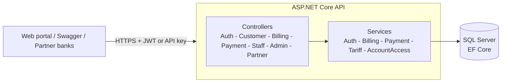

# NWSDB Smart Water Platform

A service-oriented REST API (plus a lightweight web portal) for a national water utility. It covers the whole billing lifecycle: field staff record meter readings, bills are generated automatically from a configurable tariff, customers pay online, partner banks settle bills through a B2B gateway, and every important action lands in an audit log.

**Stack:** ASP.NET Core 9 · Entity Framework Core 9 · SQL Server · JWT authentication · BCrypt · Swagger/OpenAPI · xUnit · Docker · GitHub Actions · Tailwind CSS + Chart.js (front end)

## Features

| Area | What it does |
|---|---|
| **Authentication** | Registration and login with BCrypt-hashed passwords and signed JWTs. Login accepts username or email. Auth endpoints are rate limited. |
| **Role-based access** | Four roles: Customer, Staff, Admin, Partner. Roles are assigned by the server only; public sign-up always creates a Customer. |
| **Metering and billing** | Staff record readings; the API rejects negative or decreasing values, computes consumption and generates a bill (fixed charge + units x rate). Tariffs live in the `SystemConfiguration` table. |
| **Payments** | Online settlement with business rules (no zero/negative amounts, no double payment, exact outstanding balance). Each payment produces a numbered receipt. |
| **Partner gateway** | Banks query pending bills and settle them with an `X-API-KEY` header (constant-time key comparison). |
| **Administration** | Staff provisioning, role assignment, activity (audit) log, revenue summary, tariff view, simulated backup/restore. |
| **Customer self-service** | Profile management, usage history, payment history, feedback to staff. |

## Architecture



UML diagrams (use case, class, sequence and activity) are in [`Diagrams/`](Diagrams).

## Getting started

### Option A: Docker (API + SQL Server)

```bash
cp .env.example .env        # fill in every value (see comments inside)
docker compose up --build
```

Open http://localhost:8080 for the portal and http://localhost:8080/swagger for the API docs. Migrations are applied on startup. Log in as `nwsdb_admin` with the `ADMIN_PASSWORD` you set.

### Option B: Local .NET SDK

Prerequisites: .NET 9 SDK and a SQL Server instance (LocalDB or Express is fine).

```bash
cd src/NWSDB.API

# Secrets are never stored in the repo; use user-secrets locally
dotnet user-secrets set "Jwt:Key" "$(openssl rand -base64 48)"
dotnet user-secrets set "PartnerConfig:ApiKey" "choose-a-long-random-partner-key"
dotnet user-secrets set "Seed:AdminPassword" "choose-a-strong-admin-password"
dotnet user-secrets set "Database:MigrateOnStartup" "true"

dotnet run
```

Adjust `ConnectionStrings:DefaultConnection` if you are not using the default local SQL Server.

The app refuses to start without a `Jwt:Key` of at least 32 bytes.

### Run the tests

```bash
dotnet test
```

The suite covers billing rules, payment rules, authentication (including a regression test for the role-escalation bug), object-level authorization and admin credential rotation.

## API overview

All routes are under `/api`. Everything except `Auth/*` and `Partner/*` requires `Authorization: Bearer <token>`.

| Controller | Endpoints | Access |
|---|---|---|
| Auth | `POST register`, `POST login` | Anonymous (rate limited) |
| Customer | `GET connection/{account}`, `my-connections`, `bill/{account}`, `usage/{account}`, `payment-history/{account}`, `profile/me`; `PUT profile/me`; `POST feedback` | Customer (own accounts only), Staff, Admin |
| Billing | `POST meter-reading`; `GET bills/{account}` | Staff/Admin; owner or Staff/Admin |
| Payment | `POST pay`; `GET receipt/{paymentId}` | Owner of the bill/payment, Staff, Admin |
| Staff | customers, connections, payments, feedback review | Staff, Admin |
| Admin | register staff, users, assign role, activity logs, reports, tariffs, backup/restore (simulated) | Admin |
| Partner | `GET bill/{account}`, `POST pay` | `X-API-KEY` header |

## Security notes

- Roles are never read from request bodies. `RegisterRequest` has no `Role` property, and a unit test guards against re-introducing it.
- Customers can only read or pay resources attached to their own water connections (`AccountAccessService`); Staff and Admin can access everything.
- No secrets in source control: the JWT key, partner API key and admin password come from user-secrets or environment variables. The seeded admin's placeholder hash is rotated at startup from `Seed:AdminPassword`.
- Passwords use BCrypt; a malformed stored hash fails closed (no plain-text fallback).
- CORS is closed by default (same-origin). Set `Cors:AllowedOrigins` to allow other front ends.
- Unhandled exceptions return a generic JSON error and are logged server-side only.
- `/healthz` performs a real SQL Server check.

## Known limitations / roadmap

- Backup and restore endpoints are simulated for the prototype.
- Payments are recorded internally; there is no real card gateway integration.
- Late fines and grace-period overdue handling are configured but not yet applied to bills.
- No refresh tokens or account lockout yet.
- Integration tests with `WebApplicationFactory` are a natural next step (`Program` is already exposed for that).
